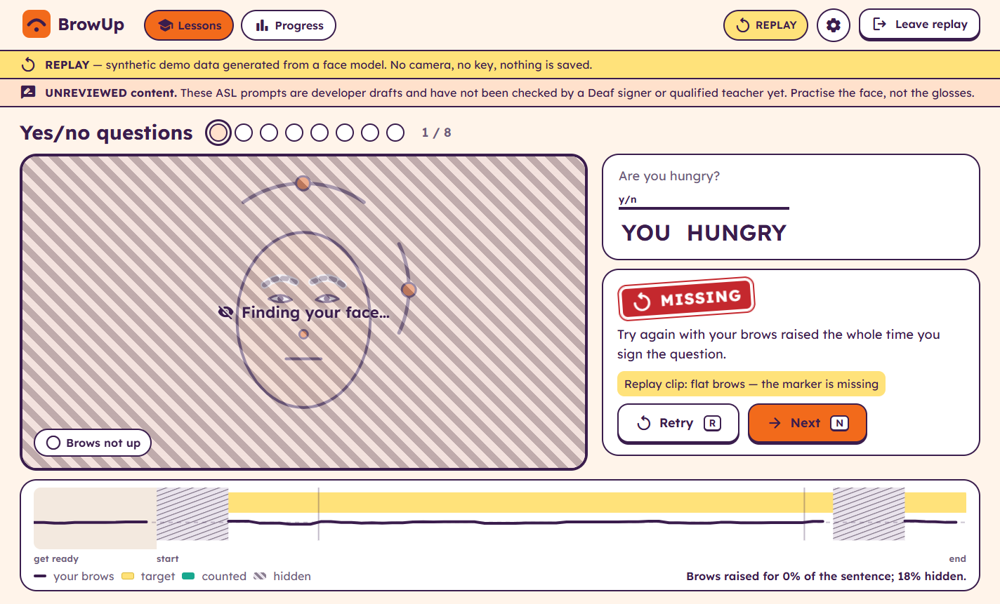
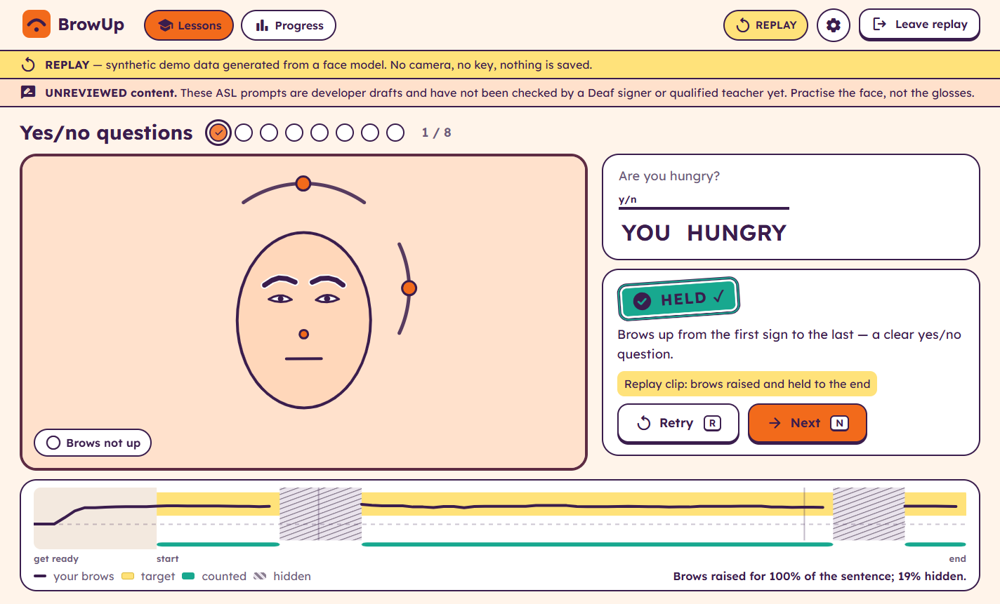

# BrowUp

**Practice and feedback for sign-language facial grammar.** Built on the Presage SmartSpectra SDK for the SmartSpectra SDK Challenge 2026.

Sign languages carry grammar on the face:

- raised brows for yes/no questions;
- furrowed brows for wh-questions;
- a head shake for negation;
- a nod for affirmation;
- raised brows on a topic.

Each is held across the whole sentence. Learners often leave these markers out or let them drop before the last sign, and they cannot watch their own face while signing. Practice apps focus on the hands, if they give feedback at all.

BrowUp is a short practice loop:

1. Read a prompt (the English meaning plus a gloss with the marker bar).
2. Sign it into the camera.
3. Get a verdict on whether the right facial marker was **present and held across the sentence**, with a timeline that shows why.

BrowUp does not recognise hand signs, and it never reads the face as emotion.

| A flat-brow attempt | The same question, brows held |
| --- | --- |
|  |  |

> ⚠️ **Content status: UNREVIEWED.** The bundled ASL prompts are developer drafts from common textbook patterns. A Deaf signer or qualified ASL teacher must review them before they are presented as correct. The app enforces this: it refuses a pack without a reviewer unless started with the developer flag, and then shows an UNREVIEWED banner. See [docs/CONTENT-REVIEW.md](docs/CONTENT-REVIEW.md).

## Run it

You need Node 20.19+ and Windows x64, macOS on Apple Silicon, or Linux x64/ARM64 (glibc 2.35+). These are the SmartSpectra Node SDK 3.5.0 platforms.

```bash
npm install                # pulls the SDK's native runtime (~350 MB)
npm run preflight          # checks SDK, camera, key, pack, build and tests
npm run demo:unreviewed    # until the content pack is reviewed
npm run demo:fresh         # same, with a clean first-run profile
# after review sign-off:
npm run demo
```

Recording a demo? Run `npm run demo:record` and press **Ctrl+Shift+R**. This developer-only recorder saves the BrowUp window as an MP4 in `Videos\BrowUp demos\`; learners' builds never contain it. See [docs/DEMO.md](docs/DEMO.md).

**Replay, no camera, no key.** On the Welcome screen, choose **Watch a replay**. It plays a bundled, clearly labelled *synthetic* session generated from a face model. For every prompt there is a common mistake and a correct production, so a judge can press <kbd>Space</kbd>, see **MISSING**, press <kbd>R</kbd> and see **HELD**. Nothing is saved.

**With a camera.** You need a SmartSpectra API key from your Presage account. Paste it in **Setup**, where it is stored encrypted with the operating system's keychain. For development, copy `.env.example` to `.env` instead. Then follow Consent → Setup → Calibrate (60 s) → Lessons.

Keys: <kbd>Space</kbd> Start (or finish early while signing) · <kbd>R</kbd> Retry · <kbd>N</kbd> Next · <kbd>Esc</kbd> Stop the camera · <kbd>1</kbd>–<kbd>4</kbd> choose the marker in mixed review.

## How markers are judged

Everything is computed from the SDK's face landmarks and blink flags. All thresholds live in [`config/thresholds.ts`](config/thresholds.ts).

**Features**, each divided by the outer-eye distance so it doesn't matter how far you sit:

- **Brow height**: brow points above the eye-corner line, measured along the face's own vertical axis so a tilted head doesn't read as a raise.
- **Inner-brow gap**.
- **Head yaw and pitch**: the nose tip against the eye corners.

All are compared with *your* neutral face and smoothed with a 3-frame median.

**Calibration** takes 60 s: a neutral face, then 3 raises, 3 furrows, 2 head shakes and 2 nods. It stores your baseline, your resting jitter (MAD) and the size of your own movements. Thresholds scale to you:

- a raise counts at min(8%, half your own raise), but never below 2.5 × your jitter;
- people whose brows move less can still get **HELD**.

**Valid frames.** A frame is dropped when:

- landmarks are missing or the tracker reset;
- the face is too dark, too bright or shared with another face;
- a blink falls within ±2 frames — eyelids drag the brow points, and without this mask rapid blinking reads as raised brows (see the blink test).

There is **no verdict from fewer than 60% valid frames**. You get **NOT SEEN** and a hint, usually "keep your hands below your eyebrows".

**Markers:**

| Marker | Present when | Held when |
| --- | --- | --- |
| Yes/no (y/n) | brows ≥ your raise threshold | present in ≥ 70% of valid frames, including the first and last 20% of the marked signs |
| Wh | brows lowered **and** inner brows drawn together | same |
| Negation (neg) | ≥ 2 head-turn reversals of ≥ the swing threshold within any 1.5 s | the shake spans ≥ 50% of the marked signs |
| Affirmation (aff) | the same on head pitch (a nod) | same |
| Topic (t) / conditional | brows raised on the first part | ≥ 70% raised on the topic **and** ≤ 30% on the comment |

The stamps are **HELD ✓**, **STARTED LATE**, **DROPPED AT END**, **NOT HELD** (dipped in the middle), **KEPT UP TOO LONG** (topic), **MISSING** and **NOT SEEN**. Each comes with one encouraging tip. If you produced a *different* marker (for example, brows up on a wh-question), the tip says so.

**Timing.** A 3-2-1 countdown starts the capture window, which is 3–5 s by sentence length and adjustable from 3 to 7 s. The first 400 ms after "Go" is reaction time and is not judged. A highlight moves across the gloss so your pace matches the marked part.

**Expressions** (SURPRISE and ANGRY scores) are optional. They are kept only if the Stage 1 test shows they agree with the measured brows on at least 80% of trials. If kept, they only label a verdict "confident" or "likely". They are never used alone, never shown as feelings and never stored.

## Features

- Consent before any camera access, then setup with a framing guide and an optional readiness check.
- Calibration with a check mark per repetition, which you can redo.
- Lesson sets from the content pack: 8 yes/no, 8 wh, 5 negation, 3 affirmation, 3 topics and 2 conditionals.
- A live mirror. The brow line turns **mint** while the target state holds, a head arc follows yaw and pitch, and hidden frames are shaded.
- Verdict stamp, one tip, and a timeline: your brow height against the lemon target band, hatched where frames were hidden, with a text summary for screen readers.
- Mixed review: shuffled sentences where you choose the marker first; scored per marker.
- Free practice: pick a marker and sign any sentence.
- Progress: one bar per marker and recent attempts. Numbers only, deletable.
- Teacher summary as Markdown: prompt ids, markers, verdicts and coverage %, no images.
- Opt-in numbers-only replays of your own practice, plus the bundled replay for judges.
- Settings: window length, sensitivity, mirror flip and reduced motion.
- No sound anywhere. Every instruction is text plus a diagram, and every verdict is a word plus an icon.

## Consent and data handling

- The camera picture is shown only on this computer. It is never recorded, saved or sent. The only exception is the developer-only demo recorder (`npm run demo:record`), which a learner's build never contains.
- BrowUp stores only your calibration (a few numbers), your results (prompt, marker, verdict, percentages) and settings. Delete them in Settings → Privacy.
- SmartSpectra runs on your computer but checks its licence online. Telemetry is off.
- There is no emotion reading, no identification and no score of fluency or ability: each verdict is about one marker in one sentence.

Details: [docs/PRIVACY.md](docs/PRIVACY.md).

## Limitations

- **Hands near the face hide landmarks.** BrowUp then says NOT SEEN rather than guessing. Prompts whose signs stay below the face work best.
- **Faces differ.** Calibration adapts the thresholds, but very subtle brow movement may still be hard to measure in poor light.
- **Sign languages differ.** Marker forms vary between and within languages (regional and personal variation). Packs for other languages ship only after review by a signer of that language.
- **Not a teacher.** BrowUp checks timing and presence of one marker. It does not judge whether a sentence is grammatical or natural.
- **Accuracy against a Deaf signer has not yet been measured.** The protocol and the table are in [docs/RESULTS.md](docs/RESULTS.md). The automated tests use synthetic faces.

## Development

```bash
npm run typecheck      # vue-tsc + tsc (strict)
npm test               # unit tests (marker rules, features, calibration, privacy, content…)
npm run test:e2e       # builds, then Playwright drives the app in replay mode
npm run fixtures       # regenerates the bundled synthetic replay (checks every clip's verdict)
npm run probe          # Stage 1 face check: landmark index overlay + guided scripts (numbers-only log)
npm run probe:analyze  # writes the Stage 1 report next to the newest probe log
```

The structure follows PLAN §4.4:

- `electron/`: main process, preload.
- `src/sensing/`: SDK client, decoding, codes, errors, recorder and replay.
- `src/face/`: landmark indices, geometry, head pose, the blink mask and calibration.
- `src/verdict/`: marker rules, coverage, oscillation, expression vote, tips.
- `src/lesson/`: controller, timing, review, progress.
- `src/views/` and `src/components/`: the Vue 3 UI.
- `content/`: schema, validator and packs.
- `fixtures/`, `tests/`, `docs/`.

SDK details and the differences from the plan are in [docs/SDK-NOTES.md](docs/SDK-NOTES.md).

## Credits

- **Content review:** *pending.* The reviewer will be credited here and in the pack.
- **SmartSpectra SDK** by Presage Technologies.
- **Lexend** typeface (SIL Open Font License), via Fontsource.
- **Material Symbols Rounded** icons (Apache 2.0), by Google.
- Vue, Pinia, Electron, electron-vite, Ajv, Vitest and Playwright (MIT and similar licences).
- SDK integration patterns adapted from the author's sibling challenge projects.

Licence: MIT (see [LICENSE](LICENSE)).
