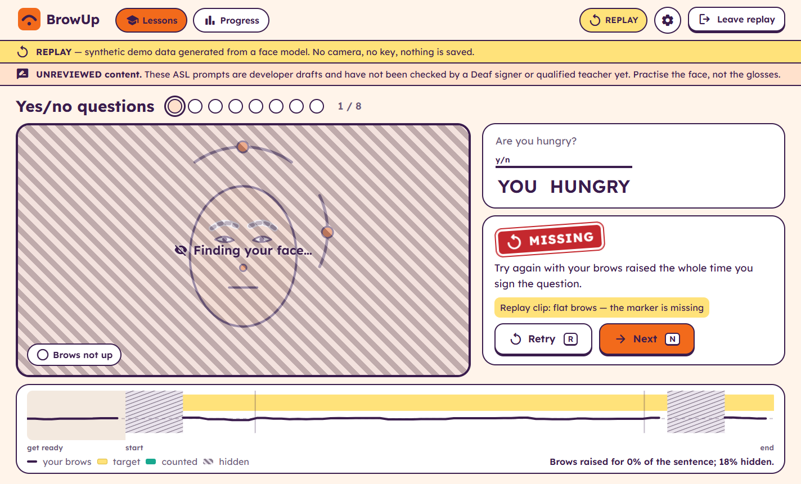
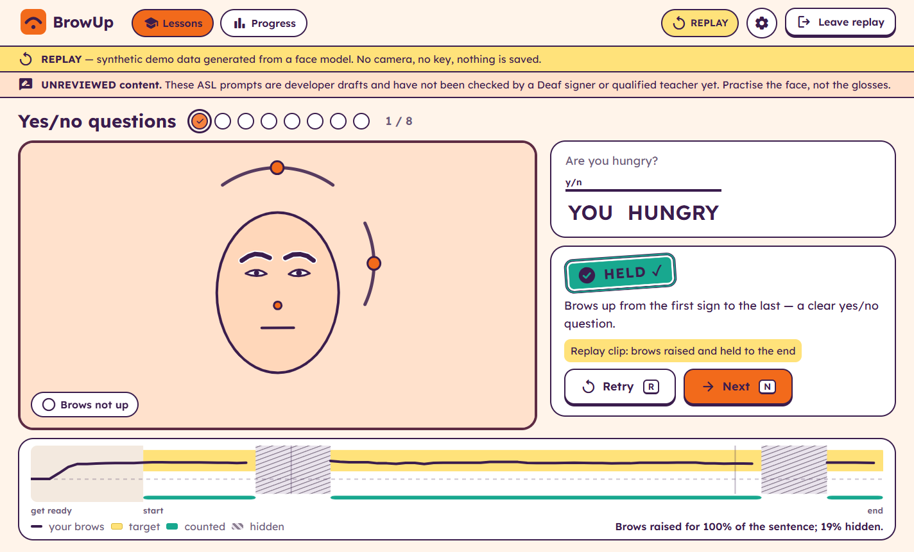
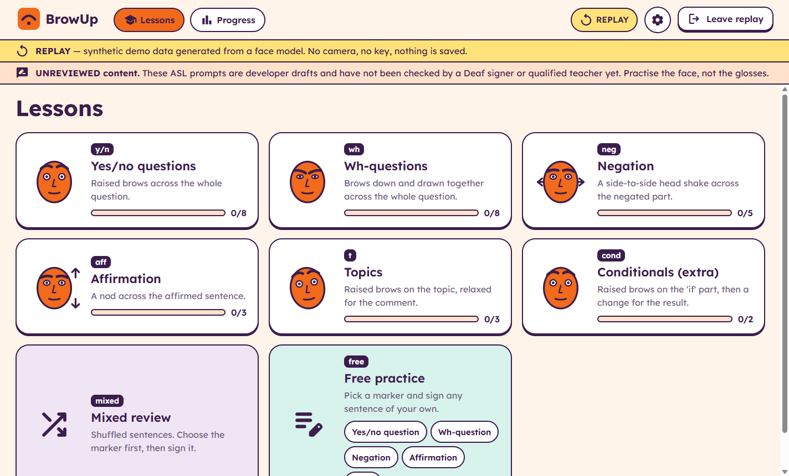

*This is a submission for the [Presage SmartSpectra SDK Challenge](https://dev.to/challenges/presage-2026-11-04)*

## What I Built

Sign languages carry grammar **on the face**. In ASL:

- **raised brows** turn a sentence into a yes/no question;
- **brows down and drawn together** mark a wh-question;
- a **side-to-side head shake** negates;
- a **nod** affirms;
- **raised brows on a topic** set it apart from the comment.

Each marker has to be **held across the whole sentence**.

Learners often leave these markers out or let them drop before the last sign, and you can't watch your own face while you sign. Practice apps focus on the hands, if they give feedback at all.

**BrowUp** is a short practice loop for the face:

1. Read a prompt: the English meaning, plus a gloss with the marker bar drawn over the signs it covers.
2. Press <kbd>Space</kbd>, wait for the 3-2-1, and sign it into your webcam.
3. Get a **verdict stamp**: **HELD ✓**, **STARTED LATE**, **DROPPED AT END**, **NOT HELD**, **MISSING** or **NOT SEEN**. A timeline shows *why*, and one encouraging tip tells you what to change.

| Flat brows on "Are you hungry?" | The same question, brows raised and held |
| --- | --- |
|  |  |

While you sign, the **brow line over your mirror turns mint** when your brows are in the target state, and a head arc follows head shakes and nods. Afterwards, the timeline plots your brow height (plum) against the lemon target band, with hatching wherever your face was hidden.


Topics are judged in two parts: brows up on the topic, **then relaxed for the comment**. Keep them up too long and you get **KEPT UP TOO LONG**.


### What's in the app

- **Consent first.** The camera stays off until you agree.
- **Setup** with a framing guide. BrowUp picks your real webcam over virtual ones.
- **60-second calibration** (neutral face, 3 raises, 3 furrows, 2 head shakes, 2 nods), so thresholds fit *your* face.
- **Lesson sets**: yes/no, wh, negation, affirmation, topics and conditionals.
- **Mixed review**: choose the marker first, then sign it. Scored per marker.
- **Free practice** with any sentence.
- **Progress** by marker, and a **teacher summary** in Markdown (numbers only).
- **A replay** that runs with no camera and no key, so judges can try it in a minute.

It is visual-first: no sound anywhere, every instruction is text plus a diagram, every verdict is a word plus an icon, and it works with the keyboard alone (<kbd>Space</kbd> <kbd>R</kbd> <kbd>N</kbd> <kbd>Esc</kbd>).



## Demo

**Narrated walkthrough (3 min).** It plays the replay bundled with the app: synthetic face data from a model, run through the same engine the live camera feeds, so every verdict appears on cue, including NOT SEEN. The narration is **Kokoro-82M**, an open-source voice model run offline. Captions are burned in, so it works with the sound off.


- 🎥 **Live attempts on my webcam:** _VIDEO LINK_
- 💻 **Code and setup:** https://github.com/unicorn-9-spec/browup

To try it without a camera:

```bash
git clone https://github.com/unicorn-9-spec/browup && cd browup
npm install
npm run demo:unreviewed   # then "Watch a replay" on the Welcome screen
```

## How I Used Presage SmartSpectra

Everything BrowUp judges comes from three SmartSpectra signals, all processed on-device through the Node SDK (`@smartspectra/node-sdk` 3.5.0) in Electron:

| Signal | What BrowUp does with it |
| --- | --- |
| **`FACE_LANDMARKS`** (478 points) | 19 of them become four features: **brow height** (brows above the eye corners, measured along the face's own vertical axis and divided by the eye distance, so it doesn't matter how far you sit), **inner-brow gap**, and **head yaw and pitch**. All are relative to *your* calibrated neutral face. |
| **`BLINKING`** | Frames within ±2 of a blink are dropped from brow measurements. Eyelids drag the brow points, so without this, rapid blinking reads as raised brows. |
| **`EXPRESSIONS`** | A second vote only. SURPRISE agreeing with a raise, or ANGRY agreeing with a furrow, labels a HELD verdict "confident" rather than "likely". It is never used alone and never shown as a feeling. |
| Validation status | Too dark, no face, more than one face and so on make the frame *hidden*. These hints appear over the mirror, and **BrowUp never gives a verdict from less than 60% visible frames**. |

The rules on top are mine:

- A **yes/no** raise counts when the brows are at least min(8%, half your own raise) above neutral, and never below 2.5 × your resting jitter. It is **HELD** when present in ≥ 70% of visible frames, *including* the first and last 20% of the marked signs.
- A **wh** furrow needs the brows lowered **and** the inner brows drawn together.
- **Negation and affirmation** need ≥ 2 head-turn reversals within 1.5 s, spanning half the sentence.

### What testing on a real face changed

I ran a 5-minute guided "face check" on my laptop webcam: 60 cued raises, furrows and neutral faces; 10 sentences signed near the face; and 15 seconds of rapid blinking. A script turned it into a report ([full report](https://github.com/unicorn-9-spec/browup/blob/main/docs/FACE-CHECK-2026-11-23.md)). The results:

- **478 landmarks at 24 per second**, with resting jitter of 1% of brow height.
- Raises were detected **20/20**.
- **All 10 signed sentences** stayed readable (72–100% of frames visible), so no prompt had to go.
- Rapid blinking produced **0 false raises** after the blink mask. Interestingly, the SDK's blink flag fired only 6 times in 15 s of rapid blinking, so BrowUp also watches the eyelid opening itself.
- SURPRISE and ANGRY scores agreed with the landmark state on **90%** of trials (median peak SURPRISE 42 on raises vs 0 at rest; ANGRY 98 on furrows vs 11). That passed my keep-or-drop bar of 80%, so expressions stayed in as the second vote.

The big finding was **head pitch**. While reading the cues my chin drifted 5–12° down, and my *relaxed* brows read up to 16% "low". ASL yes/no questions often come with a forward head tilt, so this would hide real raises. BrowUp now corrects brow height for head pitch, using a slope measured per person during calibration's nod step. On a synthetic face, a tilted yes/no question went from **MISSING to HELD** with the correction.

In my first live run of the yes/no set (8 prompts, 18 attempts, face visible 100% of the time), every prompt reached **HELD**. Along the way I got MISSING, STARTED LATE and NOT HELD, and each time the timeline showed exactly where my brows were.

## Privacy and data handling

- **The mirror stays on your computer.** The camera picture is never recorded, saved or sent.
- **Kept, as numbers only:** your calibration (baselines and ranges) and your results (prompt, marker, verdict, coverage %). Delete them in Settings → Privacy.
- **Telemetry is off.** SmartSpectra runs locally but checks its licence online.
- **No emotion reading, no identification, no fluency or ability scores.** A verdict is about one marker in one sentence.
- Unit tests enforce this: no `requestInsight`, telemetry off everywhere, no microphone, no video writes outside a developer-only demo recorder (which I used to film the demo and which a learner's build never contains), and the API key absent from logs and renderer storage.

## Content review — honestly

BrowUp teaches the grammar of a living language. **The bundled ASL prompts are developer drafts** from common textbook patterns, and **they have not yet been reviewed by a Deaf signer or ASL teacher**. The app enforces this: it refuses a content pack that has no reviewer recorded, unless it's started with a developer flag, and then shows an **UNREVIEWED** banner on every screen. The pack format and the review sheet are ready, and the reviewer will be credited in the app and the README.

## Limitations

- Hands near the face hide landmarks. BrowUp then says **NOT SEEN** instead of guessing.
- Marker forms vary between sign languages and between signers. Calibration adapts the thresholds, but BrowUp checks one marker's **presence and timing**, not whether a sentence is grammatical.
- Accuracy against a Deaf signer's own judgement hasn't been measured yet. The 40-production protocol and the results table are in the repo. The automated tests (78 unit, 12 end-to-end) use synthetic faces, which prove the rules, not real-world accuracy.

## Built with

Electron, Vue 3, Pinia, TypeScript, Ajv, Vitest and Playwright, on Presage SmartSpectra. Lexend (OFL) and Material Symbols Rounded (Apache 2.0). The walkthrough voice is Kokoro-82M by hexgrad (Apache 2.0), run offline with kokoro-onnx (MIT); it is only used for the video, not in the app.
