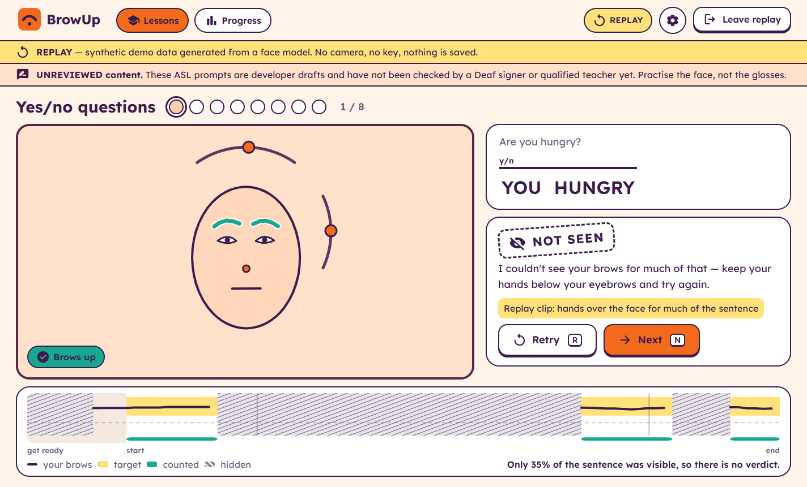
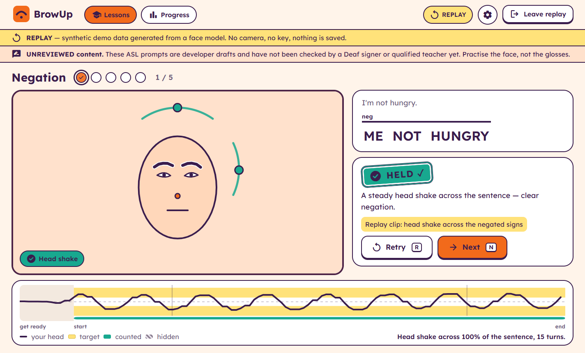
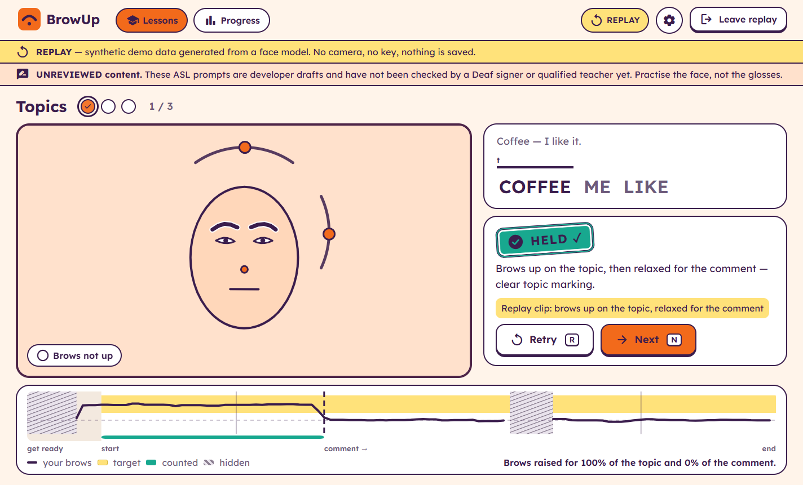
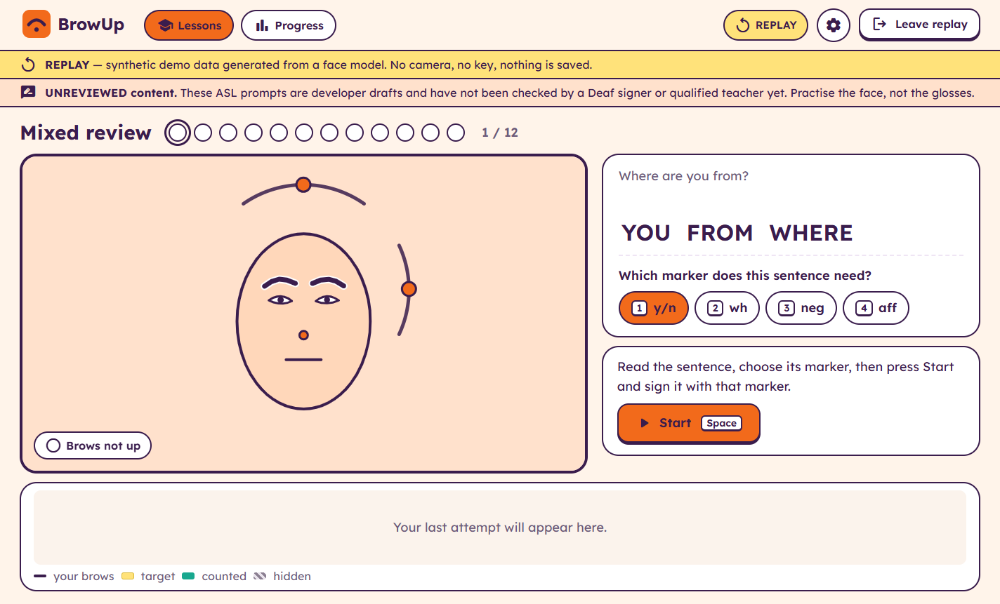
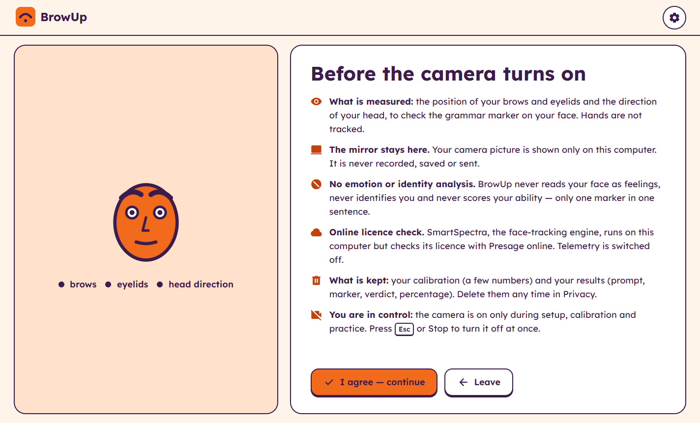
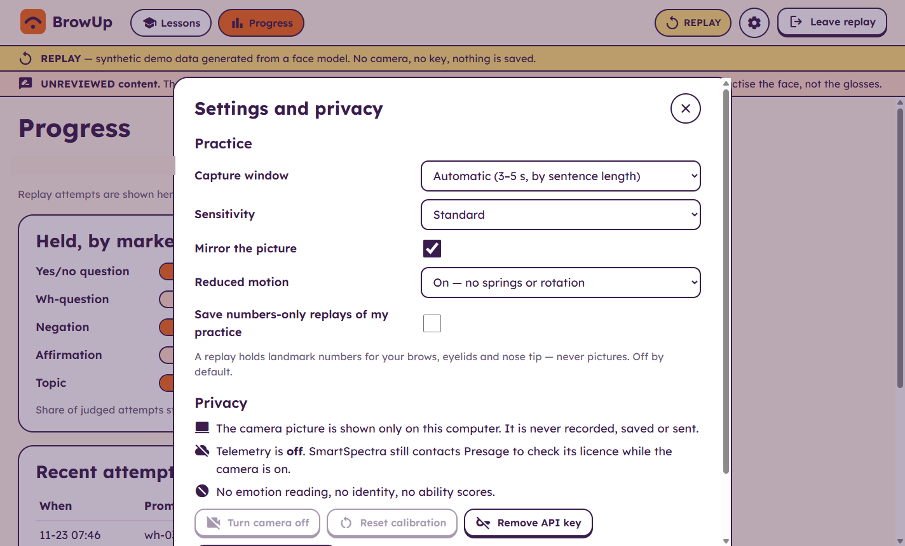

*This is a submission for the [Presage SmartSpectra SDK Challenge](https://dev.to/challenges/presage-2026-11-04)*

## What I Built

**In American Sign Language, "You're hungry." and "Are you hungry?" use the same two signs.** The only difference is your eyebrows.

Sign languages carry grammar on the face:

- **raised brows** make a yes/no question;
- **brows down and drawn together** make a wh-question;
- a **head shake** negates;
- a **nod** affirms.

Each marker has to be held across the *whole* sentence. Drop your brows before the last sign and the question becomes a statement.

Learners get this wrong constantly. They leave the marker out, start it late, or let it fade. They can't see their own face while they sign, and the apps they practise with only look at the hands, if they give feedback at all.

**BrowUp is a practice partner for the half of the grammar nobody checks.**

1. Read a prompt: the English meaning, plus the gloss with the marker bar drawn over the signs it covers.
2. Press <kbd>Space</kbd>, wait for the 3-2-1, and sign it into your webcam.
3. Get a verdict on **whether the right facial marker was there, and whether you held it from the first sign to the last.** A timeline shows exactly why, with one encouraging tip.

| Flat brows on "Are you hungry?" (replay) | Same question, brows raised and held (replay) |
| --- | --- |
|  |  |

The verdicts are specific, because "wrong" teaches nothing:

| Stamp | What it means |
| --- | --- |
| **HELD ✓** | The marker was there from the first sign to the last. |
| **STARTED LATE** | It came in after your first sign. |
| **DROPPED AT END** | It faded before your last sign, the most common learner error. |
| **NOT HELD** | It dipped in the middle. |
| **MISSING** | It wasn't there. If you made a *different* marker (brows up on a wh-question), the tip says so. |
| **NOT SEEN** | Your hands covered your brows. BrowUp **refuses to guess** and asks you to try again. |



The head counts too. **Negation** is judged from a side-to-side head shake, and **topics** in two parts: brows up on the topic, then relaxed for the comment. Keep them up too long and you get **KEPT UP TOO LONG**.

| Negation from a head shake (replay) | Topic: up for the topic, down for the comment (replay) |
| --- | --- |
|  |  |

Around that loop:

- a **60-second calibration** (neutral face, 3 brow raises, 3 furrows, 2 head shakes, 2 nods), so thresholds fit *your* face rather than an average one;
- **lesson sets** for yes/no questions, wh-questions, negation, affirmation, topics and conditionals;
- **mixed review**, where you must *choose* the marker before you sign it;
- **free practice** with your own sentences;
- **progress** by marker, and a **teacher summary** you can share.

| Lessons | Mixed review: choose the marker first |
| --- | --- |
|  |  |

## Demo

**Narrated walkthrough (3 min).** It plays the replay that ships with the app: synthetic face data from a model, run through the same engine the live camera feeds, so every verdict appears on cue. Captions are burned in, so it works with the sound off. The narration is Kokoro-82M, an open-source voice model run offline.



**On my own face, live.** In my first real run of the yes/no set (8 prompts, 18 attempts, face visible 100% of the time), every prompt reached **HELD**. Along the way I collected MISSING, STARTED LATE and NOT HELD, and each time the timeline showed exactly where my brows had gone. That is the loop doing its job.

**Try it in a minute, no camera or key needed:** `npm run demo:unreviewed`, then **Watch a replay**.

## Code

**https://github.com/unicorn-9-spec/browup** (MIT)

```bash
git clone https://github.com/unicorn-9-spec/browup && cd browup
npm install                 # Node 20.19+, Windows x64 / macOS Apple Silicon / Linux
npm run preflight           # checks the SDK, camera, key, content, build and tests
npm run demo:unreviewed     # "Watch a replay" needs no camera and no key
```

For the live camera, paste your SmartSpectra API key in **Setup**. It is stored encrypted by the operating system.

The README covers setup, how every marker is judged, privacy and limitations. Tests: **78 unit** (marker rules, calibration, privacy guarantees) and **12 end-to-end** (Playwright drives the whole lesson loop with the keyboard alone).

## How It Responds to Human Signals

BrowUp uses three live SmartSpectra signals, all processed on-device by `@smartspectra/node-sdk` 3.5.0 inside Electron:

| Signal | What happens in real time |
| --- | --- |
| **Face landmarks** (478 points, ~24 per second) | 19 points become **brow height**, **inner-brow gap** and **head yaw and pitch**. Each is measured along the face's own axes and divided by the eye distance, so tilting your head or leaning back doesn't fake a result. While you sign, the **brow line drawn over your mirror turns mint** whenever your brows are in the target state, and a **head arc** swings with your head shakes and nods. |
| **Blinking** | Frames around a blink are excluded from brow measurement. Eyelids drag the brow landmarks, so without this, blinking reads as raised brows. |
| **Expressions** | A *second vote* only. SURPRISE agreeing with raised brows, or ANGRY agreeing with a furrow, upgrades a verdict from "likely" to "confident". It is never used alone and never shown as a feeling. |
| **Validation status** | Too dark, face turned away, more than one face: the frame is hidden, the SDK's hint appears over the mirror, and **there is never a verdict from less than 60% visible frames**. |

**How I integrated the SDK:**

1. **Main process:** `bindSmartSpectraIpc(window)`. The API key lives here, encrypted with `safeStorage`.
2. **Preload:** the SDK's bridge plus a narrow app API, with context isolation and sandbox on.
3. **Renderer:** one `getUserMedia` stream (video only) feeds both `sdk.useMediaStream()` and the mirror. `metrics` packets go through `decodeMetrics()` into a feature pipeline; `validationStatus` and `error` become plain-language banners.
4. **Telemetry off** everywhere (`enableTelemetry: false`, unit-tested), and `requestInsight` is never called.
5. **Shutdown:** camera tracks stop first, so the light goes off at once, then `stop()` and `destroy()`. <kbd>Esc</kbd> turns the camera off in about 50 ms.

**What a real face taught me.** Before tuning anything, I ran a 5-minute guided face check on my webcam: 60 cued raises, furrows and neutral faces; 10 sentences signed near the face; and 15 seconds of rapid blinking ([full report](https://github.com/unicorn-9-spec/browup/blob/main/docs/FACE-CHECK-2026-11-23.md)).

- Brow raises were detected **20 out of 20**.
- **All 10** sentences signed near the face stayed readable.
- Rapid blinking produced **zero** false raises.
- The expression scores agreed with the landmarks on **90%** of trials, which is why they earned their place as a second vote.

The surprise was **head pitch**. While reading the cues, my chin drifted 5–12° down, and my *relaxed* brows read as much as 16% "low". ASL yes/no questions often come with a forward head tilt, so a real raise could have scored MISSING. BrowUp now corrects brow height for head tilt, using a slope it measures for each person during the nod step of calibration. On a test face, a tilted yes/no question went from **MISSING to HELD**.

## Prize Categories

**Best Thoughtful Real-World Use.**

- **The need.** Facial grammar is one of the hardest parts of learning a sign language, and the hardest to self-check. You can watch your hands, but not your face mid-sentence. Between classes, learners practise with no feedback at all.
- **Who it's for:**
  - adult learners of ASL, the default content;
  - their teachers, who get a numbers-only summary of attempts;
  - other sign languages, through a content-pack format that loads only after review by a signer of that language.
- **Designed to be usable by them:**
  - **Visual-first, zero sound.** It's a tool for a visual language, and every instruction is text plus a diagram.
  - **Verdicts as a word plus an icon,** never colour alone.
  - **Full keyboard control:** <kbd>Space</kbd> <kbd>R</kbd> <kbd>N</kbd> <kbd>Esc</kbd>.
  - **Reduced motion,** a 3 px focus ring and 18 px text.
  - **Calibrated to your face,** so expressive and subtle faces are judged fairly.
  - **Honest when it can't see:** NOT SEEN instead of a guess.
  - **Encouraging tips,** such as "Almost — keep your brows up until the last sign", never "wrong".
- **Respect for the language.** BrowUp teaches the grammar of a living language that belongs to the Deaf community, so **content isn't presented as correct until a Deaf signer or qualified teacher has reviewed it.** The app enforces this. The bundled ASL prompts are still developer drafts awaiting that review, and every screen says so with an **UNREVIEWED** banner. The review sheet and pack format are ready, and the reviewer will be credited.

## Consent and Data Handling



- **Camera consent:** a consent card comes **before any camera access**. It says what is measured (brows, eyelids, head direction), that the mirror stays on the computer, that nothing is recorded, and that there is no emotion or identity analysis. The camera is on only during setup, calibration and practice, a **Camera on** pill shows whenever it is, and <kbd>Esc</kbd> or **Stop** turns it off at once.
- **Storage:** your calibration (a few baseline numbers), your results (prompt, marker, verdict, coverage %) and settings, kept locally. Your API key is encrypted by the operating system and never logged. **No video, images or face mesh are ever stored or sent.** Optional practice replays save landmark *numbers* only, and are off by default.
- **Sharing:** none. The teacher summary is a Markdown file you create and share yourself, holding prompt ids, verdicts and percentages.
- **Retention and deletion:** data is kept until you delete it. Settings → Privacy has **Delete my progress**, **Reset calibration** and **Remove API key**, and shows where each file lives.
- **SDK telemetry:** **off.** SmartSpectra runs on-device but checks its licence with Presage online, and the app says so.
- **Optional AI services:** none.
- **What BrowUp does not do:** no emotion reading, no identification, no scores of fluency or ability, and no health or medical claims. A verdict is about one marker in one sentence, nothing more.
- **Enforced by tests:** unit tests fail if telemetry is turned on, if `requestInsight` appears, if the microphone is requested, or if any code outside a developer-only demo recorder can capture video. That recorder never ships to learners.



## Agent Session

BrowUp was planned and built with **Claude Code**: the plan, the code, the tests, the face-check analysis that found the head-pitch problem, and this walkthrough.

<!-- Upload the transcript at https://dev.to/agent_sessions/new, check it for keys and personal data, click "Make Public", and embed it here. -->

---

*Built with Electron, Vue 3, Pinia, TypeScript, Ajv, Vitest and Playwright on Presage SmartSpectra. Lexend (OFL) and Material Symbols Rounded (Apache 2.0). Walkthrough voice: Kokoro-82M (Apache 2.0) via kokoro-onnx (MIT), used only for the video.*
